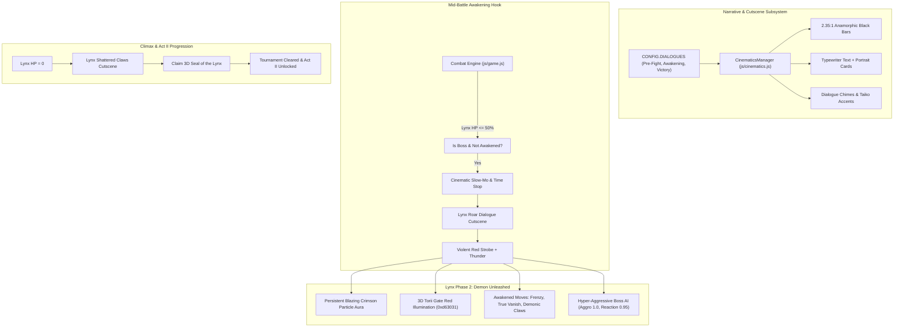

# Boss Awakening & Dialogue Cinematics System Specification

**Feature:** Act I Climax: Lynx Multi-Phase Boss Awakening, Visual Novel Cutscenes & Story Dialogue  
**Date:** 2026-10-29  
**Status:** In Review (Pending User Approval)  
**Author:** Pair Programming Agent  

---

## 1. Overview & Objectives

In authentic *Shadow Fight 2*, the tournament climax against **Lynx (Demon of the Claws)** is not an ordinary match. It is a cinematic turning point where the story unfolds through traditional Japanese dialogue scenes, and the boss transforms mid-battle into an enraged Demonic entity with heightened lethality, terrifying speed, and unique supernatural abilities.

This specification details the architecture for:
1. **Cinematic Dialogue Engine (`js/cinematics.js`):** Anamorphic letterbox bars, illustrated character portrait panels (Shadow, Sensei, Lynx, Disciples), typewriter text effect, dialogue sound chimes, and interactive progression.
2. **Story Narrative Scripts (`CONFIG.DIALOGUES`):** Pre-fight banters for tournament disciples, an authentic 3-act story exchange before Lynx, mid-battle Phase 2 awakening dialogue, and post-battle victory/Seal sequence.
3. **Lynx Multi-Phase Boss Mechanics (`js/fighter.js` & `js/ai.js`):** Real-time HP monitoring (50% threshold), cinematic time freeze, transformation sequence, persistent crimson demon aura, 3D Torii Gate red ambient lighting, and 3 Awakened Boss Abilities (`LYNX_FRENZY`, `LYNX_TRUE_VANISH`, `LYNX_DEMONIC_CLAWS`).
4. **Procedural Audio & Visual Polish (`js/audio.js` & `js/renderer.js`):** Demonic roar, Shakuhachi dialogue chimes, thunder flashes, and Act II Seal of the Lynx acquisition.

---

## 2. Architecture & Subsystems



---

## 3. Detailed Component Specifications

### 3.1 Cinematic Cutscene Engine (`js/cinematics.js`)
- **Visual Presentation:**
  - Responsive letterbox black bars (`.cinematic-bar-top`, `.cinematic-bar-bottom`) animating in smoothly with `transform: translateY(0)` over 350ms.
  - Floating visual novel dialogue box (`.cinematic-dialogue-box`) positioned at the lower third of the canvas with dark lacquer finish, gold filigree border, and textured sumi parchment backdrop.
  - Character portrait cards (`.cinematic-portrait-card`):
    - **Left Speaker:** Shadow (mysterious dark silhouette with glowing cyan eyes) or Sensei (wise elder with woven straw kasa).
    - **Right Speaker:** Opponent disciple or Demon Lynx (glowing red eyes, horned helm, demonic fangs).
  - Character name badge with Japanese calligraphy accent (e.g. `師父 SENSEI`, `影 SHADOW`, `山猫 LYNX`).
- **Interactive Controls:**
  - Typewriter animation (25ms per character) with instant-finish on first tap/press.
  - Next line trigger: Click anywhere, tap touch screen, or press `Space` / `Enter`.
  - Skip button (`.cinematic-skip-btn`): Immediately fast-forwards to the end of the current dialogue sequence.
  - Zero disruption to combat loop when closed: restores game time-scale and resumes fighting.

### 3.2 Story Dialogues Matrix (`CONFIG.DIALOGUES` in `js/config.js`)
1. **Disciple Quick Banters (Pre-Fight):**
   - **Shin:** *"I have trained under the Master for three winters. Let us test your shadow arts!"*
   - **Brick:** *"Your bones will splinter against my fists like brittle bamboo!"*
   - **Needle:** *"Blink, and you will find steel through your throat."*
   - **Ghost:** *"The chain of the reaper never returns empty, stranger."*
2. **Lynx Pre-Fight Cutscene (`LYNX_PRE_FIGHT`):**
   - **Line 1 (Sensei):** *"Shadow, steel your mind. Lynx is no ordinary fighter—he commands the demonic powers of the Shadows!"*
   - **Line 2 (Lynx):** *"Hahaha! A wandering silhouette without a face dares challenge the Demon of the Claws? Let us see how brightly your blood burns upon my steel!"*
   - **Line 3 (Shadow):** *[Draws weapon with silent resolve, eyes gleaming with cyan light]*
3. **Lynx Awakening Cutscene (`LYNX_AWAKENING`):**
   - **Line 1 (Lynx):** *"Insolent worm! You thought you had pushed me to the brink?! Behold the true curse of the Demon Order!"*
   - **Trigger Action:** Screen shakes with quadratic trauma 1.0, deep thunder crack, violent crimson screen flash, and Lynx transforms into his Phase 2 Demon Form.
4. **Lynx Defeat & Seal Acquisition (`LYNX_VICTORY`):**
   - **Line 1 (Lynx):** *"Impossible... my claws... shattered by a mere mortal shadow... Take the Seal, fool... but the Gates will consume you!"*
   - **Line 2 (Sensei):** *"Well fought, Shadow! The first demon of the Order has fallen, and the Seal of the Lynx is in our grasp. The Gates of Shadows await!"*
   - **Reward Screen:** Animated 3D rotating Seal of the Lynx with +1000 Coins, +20 Gems, and "ACT I CONQUERED" banner.

### 3.3 Lynx Multi-Phase Boss Engine (`js/fighter.js` & `js/ai.js`)

#### Phase 1: The Demon Disciple
- Lynx fights with standard agility, signature Lynx Claws, occasional smoke bomb, and Wind Talisman magic.
- Boss health bar clearly marked with Demon Skull crest 👹.

#### Phase 2 Awakening Trigger:
- Evaluated inside `fighter.takeHit()`:
  ```javascript
  if (this.isBoss && !this.hasAwakened && this.hp <= this.maxHp * 0.5) {
    this.hasAwakened = true;
    window.Game.triggerBossAwakening(this);
  }
  ```
- Instant slow-motion freeze (`window.Game.slowMotionFrames = 40`).
- Plays `Sound.playBossRoar()` and launches `LYNX_AWAKENING` dialogue.
- Upon dialogue completion:
  - `this.isAwakened = true;`
  - Restores 20% enraged bonus shield HP.
  - Transforms visual aura to blazing demonic scarlet (`rgba(231, 76, 60, 0.95)`).
  - Emits rising flame ember particles and sets 3D arena lighting to menacing crimson (`0xd63031`).

#### Awakened Boss Abilities:
1. **Shadow Claws Frenzy (`LYNX_FRENZY`):**
   - 5-hit rapid forward claw slash combo (18 base dmg/hit).
   - Each hit leaves a bloody red ink trail and ends in an explosive cross-slash launching Shadow backward.
2. **True Shadow Vanish (`LYNX_TRUE_VANISH`):**
   - Lynx completely dematerializes from the canvas for 1.8 seconds (110 frames).
   - Only two glowing ruby-red eyes remain visible in the darkness tracking the player.
   - Reappears instantaneously directly above Shadow with a high-velocity aerial dive kick (`vy = 18.0`).
3. **Demonic Claws Eruption (`LYNX_DEMONIC_CLAWS`):**
   - Rips open the arena floor, summoning 3 giant crimson demon claws beneath Shadow's feet dealing 38 damage and airborne juggle.

#### Awakened Combat AI (`js/ai.js`):
- `aiAggro` boosted to `1.0` (relentless offensive pacing).
- `aiReaction` boosted to `0.95` (blocks 95% of incoming neutral strikes unless whiffs are punished).
- Executes `LYNX_TRUE_VANISH` if Shadow attempts to camp or throw shurikens from afar.
- Automatically initiates `LYNX_FRENZY` whenever Shadow is forced against the arena wall.

### 3.4 Procedural Audio Synthesizers (`js/audio.js`)
All sound assets are generated via Web Audio API without external file dependencies:
- `playBossRoar()`: Dual-oscillator sub-bass frequency-modulated growl with low-pass resonance sweep.
- `playDemonicThunder()`: Explosive white-noise burst with sharp exponential decay and bass boom.
- `playDialogueChime()`: Resonant bell/bamboo tap pitched to traditional Japanese pentatonic scale (Insen mode).
- `playSealAcquired()`: Multi-tone harmonious celestial gong celebrating Act I victory.

---

## 4. Acceptance & Verification Criteria

1. **Dialogue Presentation:**
   - Pre-fight cutscene reliably triggers when challenging Lynx from the Tournament screen.
   - Text types smoothly with typewriter SFX, and [SKIP] immediately bypasses without hang.
2. **Mid-Fight Awakening:**
   - When Lynx reaches $\le 50\%$ HP, combat cleanly pauses in slow motion.
   - The Awakening dialogue plays, followed by thunder and screen strobe.
   - Lynx gains persistent red flame aura and glowing red eye trails.
   - The 3D Torii Gate and arena floor dynamically shift from warm sunset orange to deep blood crimson.
3. **Awakened Abilities:**
   - Lynx executes `LYNX_FRENZY` (5-hit combo) and `LYNX_TRUE_VANISH` (disappearing completely except for glowing eyes).
4. **Victory Flow:**
   - On K.O., Lynx falls to his knees, shattered claws effect triggers, and the post-battle dialogue plays.
   - Player is awarded the Seal of the Lynx, bonus coins, and rubies.
5. **Quality Gate:**
   - 0 console errors throughout dialogue playback, mid-fight awakening, and post-fight victory.
   - Automated Playwright verification script capturing visual screenshots of all phases.

---

## 5. User Decision Gate

Please review this specification. Once you approve it, we will immediately generate the step-by-step implementation plan and begin inline execution!

